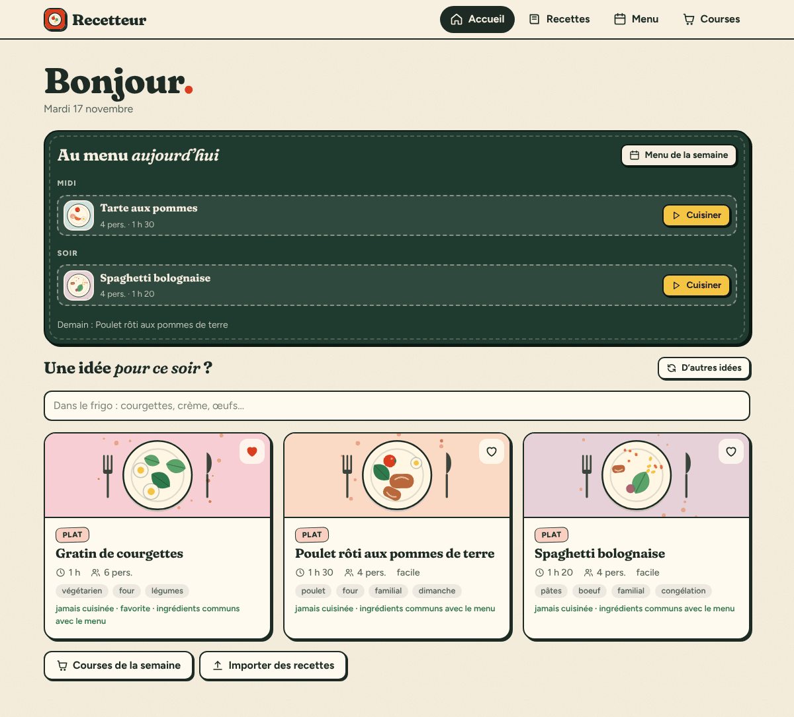
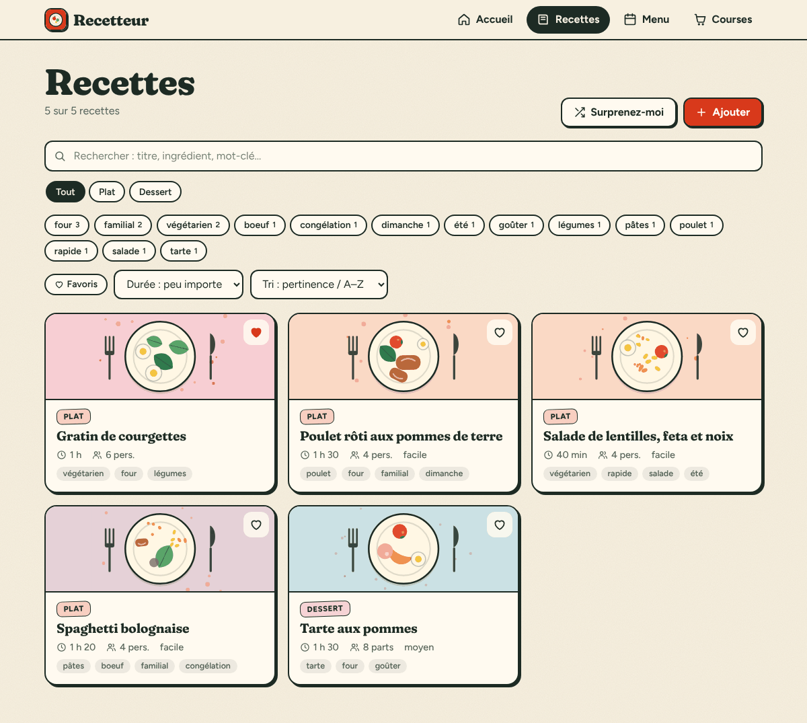
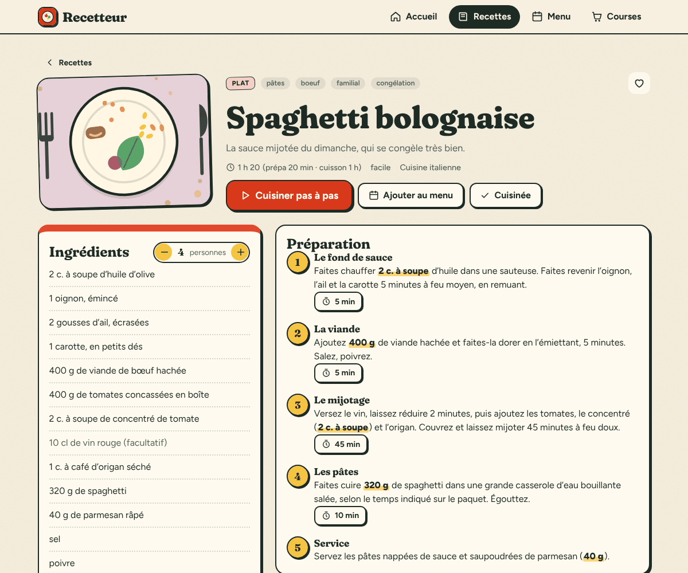
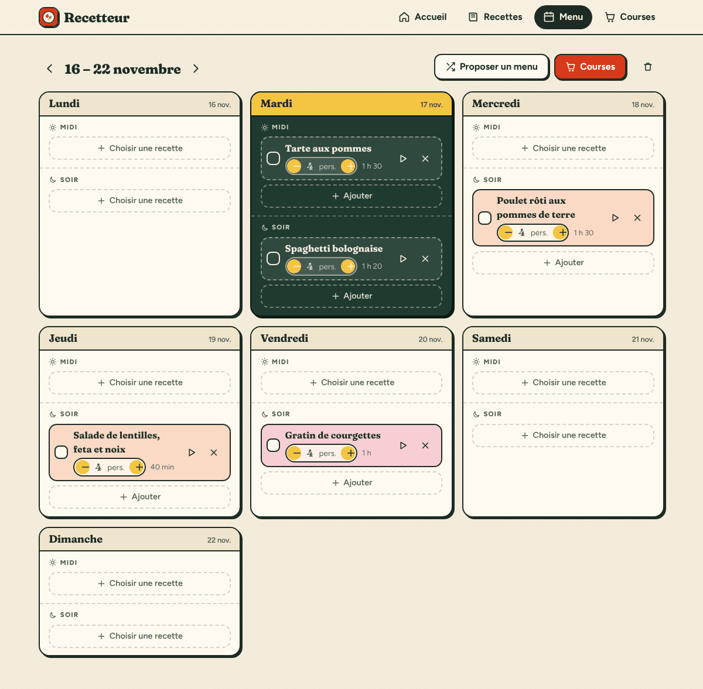
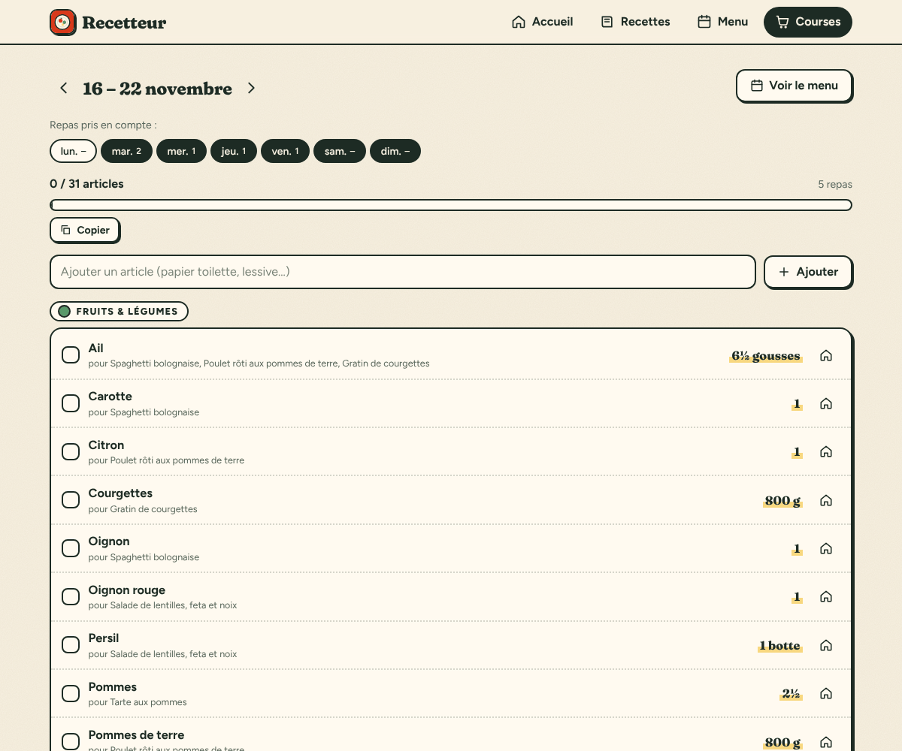
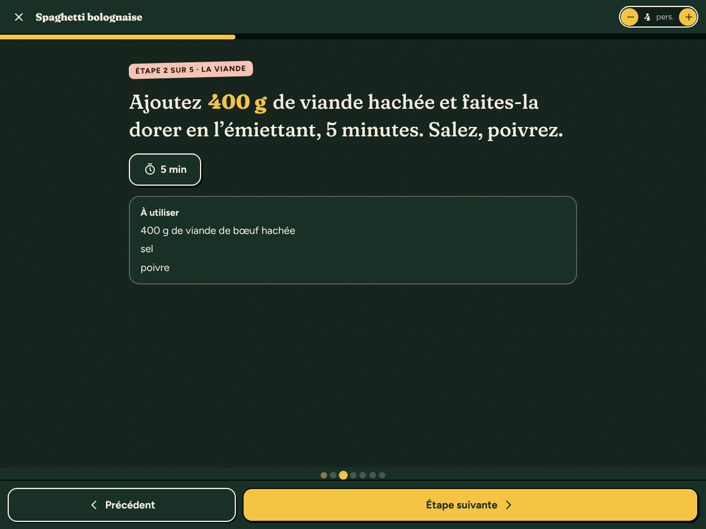
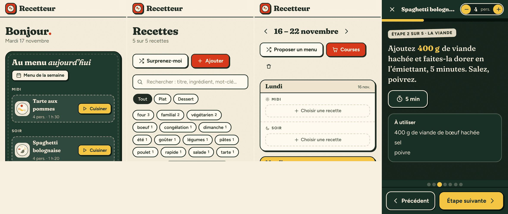

# Recetteur

Vos recettes, le menu de la semaine, la liste de courses et la recette **pas à pas** avec des quantités qui
s'ajustent au nombre de personnes. Conçu comme une **app Home Assistant** (comme [Trouveur](https://github.com/jogaulupeau/trouveur)),
mais utilisable seul.



| | |
|---|---|
|  |  |
|  |  |
|  |  |

- **Zéro dépendance** : Node.js ≥ 20 et sa bibliothèque standard. Interface en JavaScript pur, sans étape de build.
- **Recettes générées avec Claude** : un [skill](skill/recettes-recetteur/SKILL.md) impose le format d'import.
- Données en simples fichiers JSON.

## Design

« Carnet d'épicerie fine » : papier et encre verte, tomate et beurre. Titres en [Fraunces](https://github.com/undercasetype/Fraunces)
et texte en [Figtree](https://github.com/erikdkennedy/figtree), **embarquées** (`public/fonts/`, licence SIL OFL) : l'app est identique
hors ligne, derrière l'ingress. Chaque recette reçoit une **assiette illustrée générée** d'après son titre et ses ingrédients
(`public/js/art.js`), sans photo à stocker ; le menu du jour est une ardoise ; le mode cuisine est sombre et très lisible à bout de bras.
Thèmes clair et sombre automatiques (selon l'appareil).

## Installation dans Home Assistant

Voir [addon/DOCS.md](addon/DOCS.md). En bref : *Boutique → ⋮ → Dépôts → `https://github.com/jogaulupeau/recetteur`*.

## Lancer en local

```bash
npm start                # http://127.0.0.1:8099/ — données dans ./data
PORT=9000 RECETTEUR_DATA_DIR=/chemin npm start
npm test
```

Variables : `PORT` (8099), `HOST` (127.0.0.1 ; l'app Home Assistant utilise 0.0.0.0, sans publier le port),
`RECETTEUR_DATA_DIR` (`./data`), `RECETTEUR_OPTIONS` (`/data/options.json`, options de l'app :
`portions_defaut`, `ha_todo_entity`, `alerte_media_player`, `alerte_voix`, `alerte_son`, `log_level`), `SUPERVISOR_TOKEN`
(active les appels à Home Assistant : courses → liste todo, alerte des minuteurs → enceinte), `HA_API_BASE` (simuler
Home Assistant en développement).

## Le skill Claude

`skill/recettes-recetteur/` est un skill complet (instructions, référence du format, exemple, validateur Node
autonome) qui fait produire à Claude un JSON `recetteur/v1` à coller dans **Recettes → Ajouter**.

- **Claude perso (claude.ai / application)** : téléversez [`skill/recettes-recetteur.zip`](skill/recettes-recetteur.zip)
  dans *Réglages → Capacités → Skills → Téléverser un skill* (exécution de code activée). Pour un usage en
  conversation, Claude donne un résumé puis un bloc JSON unique, et, s'il peut créer des fichiers, un `recettes.json`.
- **Claude Code** : dézipper dans `~/.claude/skills/`.
- Régénérer l'archive après toute modification du skill : `npm run skill:zip` (déterministe, vérifiée par un test).

```bash
node shared/validate-cli.js recettes.json              # rapport
node shared/validate-cli.js recettes.json --normaliser # JSON normalisé sur stdout
```

Format détaillé : [skill/recettes-recetteur/references/format.md](skill/recettes-recetteur/references/format.md).
Le point clé pour l'ajustement des quantités : dans le texte des étapes, `{{id}}` est remplacé par la quantité
mise à l'échelle de l'ingrédient (« Ajoutez {{boeuf}} de viande » → « Ajoutez 600 g de viande »).

## Organisation

```
shared/    logique pure, utilisée par le navigateur, le serveur, les tests et le skill
             quantity.js (échelle, arrondis, français)  recipe.js (validation)  shopping.js (courses)
             search.js  suggest.js (propositions, menu auto)  steps.js  dates.js  aisles.js  vocab.js
server/    node:http, API JSON + fichiers statiques, stockage JSON atomique (store.js)
public/    interface (hash routing, chemins relatifs : fonctionne sous l'ingress)
skill/     skill Claude + recettes-recetteur.zip à téléverser (modules de shared/ copiés : `npm run sync-skill`, puis `npm run skill:zip`)
addon/     app Home Assistant : config.yaml, Dockerfile, run.sh, DOCS.md ; addon/app/ est généré
examples/  recettes d'exemple (chargeables depuis l'interface)
```

## Développement

- `npm test` : logique métier, API (serveur réel sur un port éphémère), cohérence du packaging.
- **Après toute modification du code** : `npm run package` (recopie dans `addon/app/`, que Home Assistant construit)
  et, si `shared/` ou le skill ont changé, `npm run sync-skill` puis `npm run skill:zip`. Des tests échouent tant que ce n'est pas fait.
- Pas de service worker ni de manifest PWA : dans Home Assistant c'est l'application mobile qui joue ce rôle.

## Idées pour la suite

Import d'une recette depuis une URL, photo des plats, garde-manger avec quantités, repas « restes », export
iCal du menu, capteur Home Assistant « plat du jour ».
